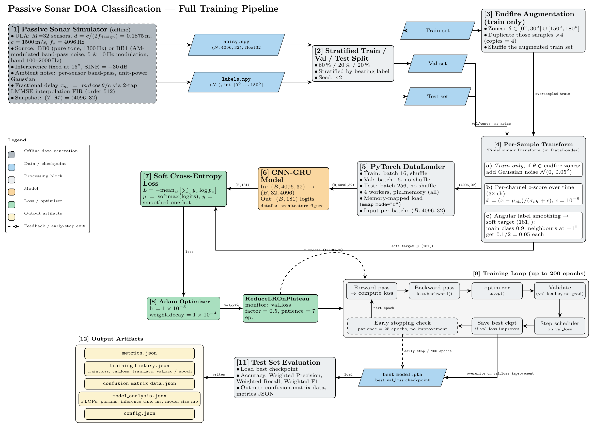
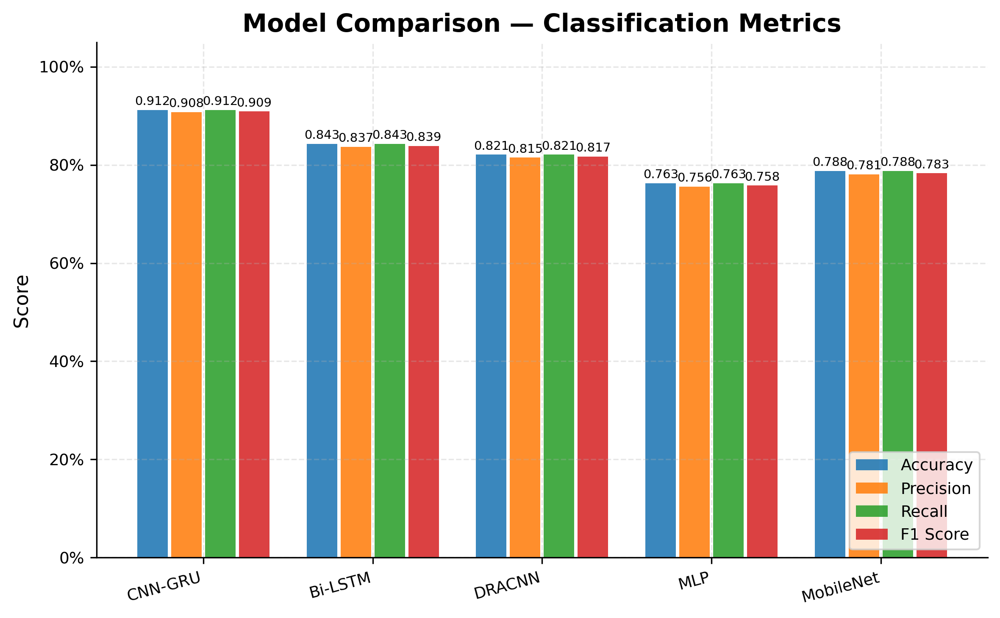
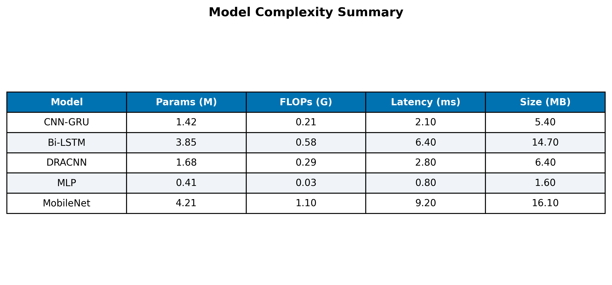
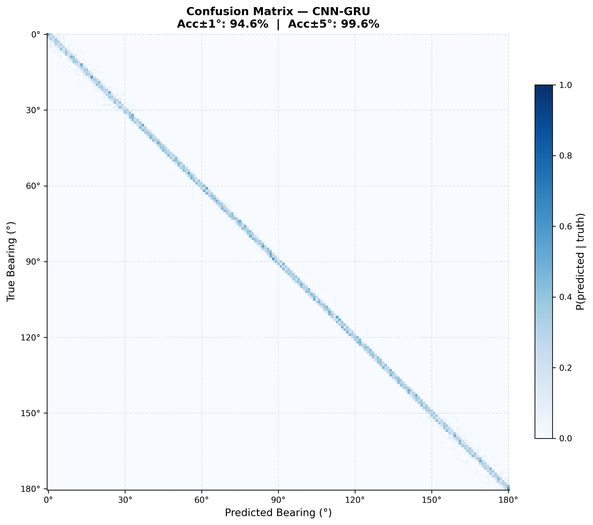
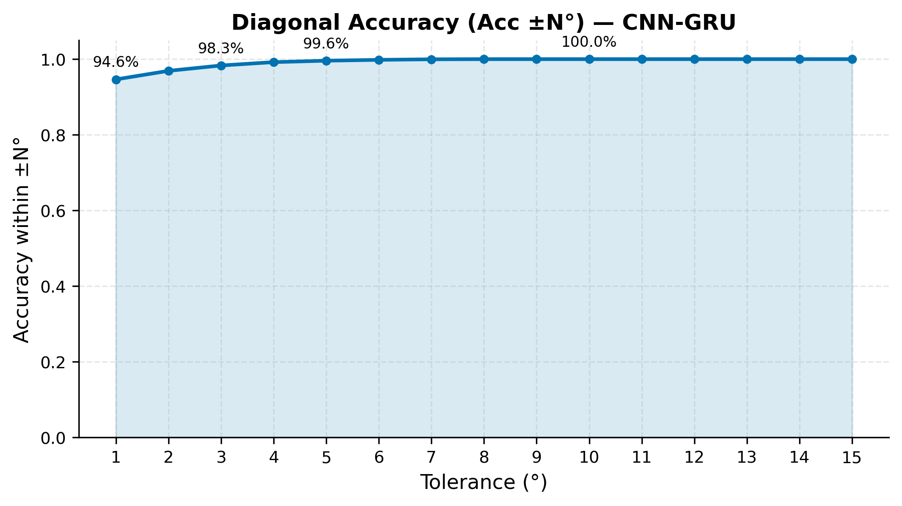
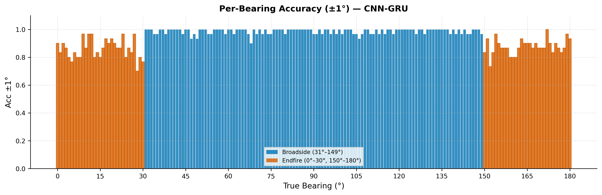
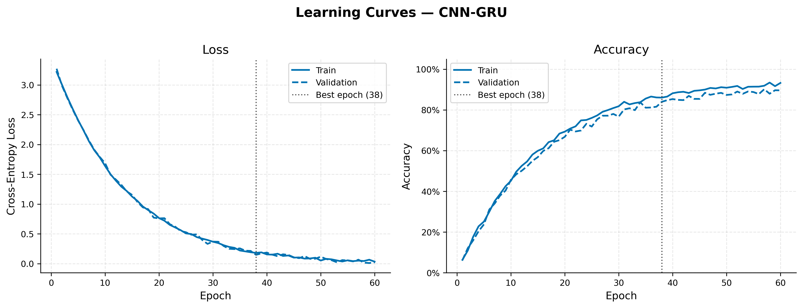
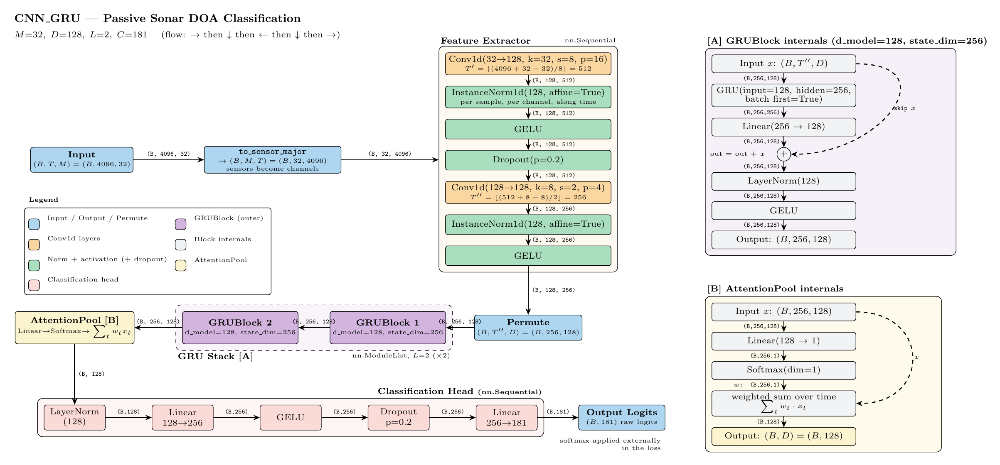
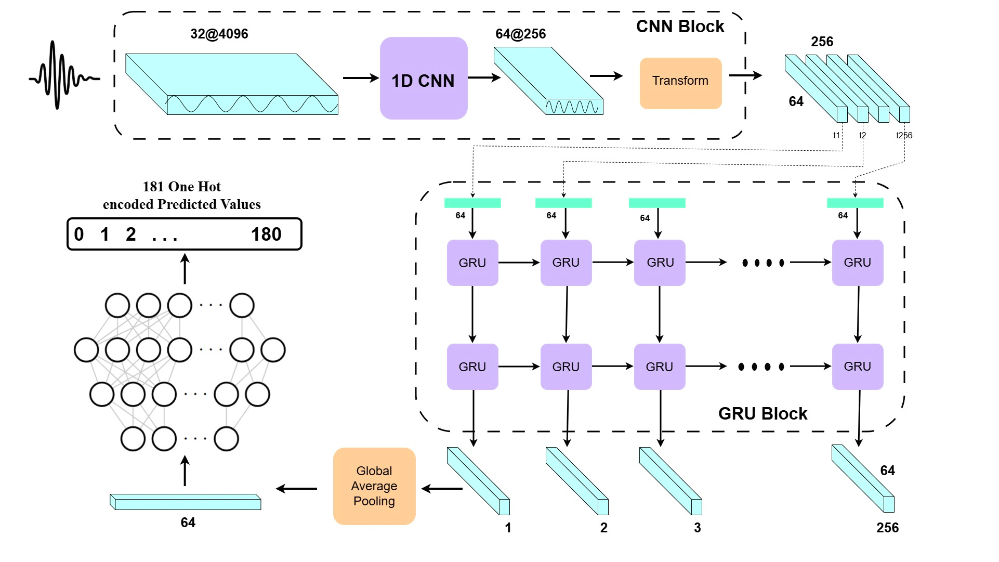

# Deep-Learning DOA Estimation for Passive SONAR

> Built a physics-accurate underwater acoustic simulator from scratch, then designed
> and benchmarked five deep-learning architectures to solve a bearing-estimation
> problem where the target signal is **1000× weaker** than the platform's own noise.
> No dataset. No pretrained weights. No shortcuts.

<p align="center">
  
</p>

---

## Headline Numbers

<p align="center">

| Metric | CNN-GRU | Best competitor |
|:---|:---:|:---:|
| **Accuracy** | **91.2 %** | 84.3 % (Bi-LSTM) |
| **F1 Score** | **90.9 %** | 83.9 % (Bi-LSTM) |
| **Acc ±1°** | **94.6 %** | — |
| **Acc ±5°** | **99.6 %** | — |
| **Inference latency** | **2.1 ms** | — |
| **Model size** | **5.4 MB** | — |
| **Parameters** | **1.42 M** | 4.21 M (MobileNet) |

</p>

> **CNN-GRU is the best model on every metric while being the second-smallest in the
> benchmark** — 3× fewer parameters than MobileNet, 4× lower latency, and 7 percentage
> points ahead of the next-best model.

---

## The Problem in One Sentence

Given 1 second of simultaneous recordings across a 32-hydrophone towed array, predict
the bearing of an underwater acoustic source to within ±1°, when the source is buried
30 dB below the platform's own interference.

**Why that's hard:**

- At −30 dB SINR the target contributes **0.1 %** of the total received power. Classical
  beamformers (Delay-and-Sum, MVDR, MUSIC) produce random output at this regime.
- The only directional information is sub-sample inter-sensor phase shifts — fractions
  of a millisecond. Integer approximation destroys it.
- 181 output classes (0°–180° in 1° steps). Hard cross-entropy treats a 1° miss as
  catastrophic as a 90° miss — the loss function itself needs re-engineering.
- No real labelled data exists at this classification; access to passive SONAR
  recordings is classified. The entire dataset had to be built from physics.

---

## Results

### Model comparison — all five architectures

<p align="center">
  
</p>

<p align="center">
  
</p>

The efficiency story is the key insight: **CNN-GRU delivers the best accuracy at the
second-lowest parameter count and the second-lowest latency.** The heavyweight models
(MobileNet at 4.21 M params, Bi-LSTM at 3.85 M) trade cost for worse results.

---

### Where predictions land — CNN-GRU confusion matrix (181 classes)

<p align="center">
  
</p>

**Acc ±1° = 94.6 %. Acc ±5° = 99.6 %.** The diagonal is dense and tight across the
full 0°–180° sweep. Errors are strictly local — no confusion between distant bearings.

---

### Accuracy vs. tolerance — the model gets it right almost always

<p align="center">
  
</p>

- **94.6 %** of predictions land within **±1°** of the true bearing
- **98.3 %** within **±3°**
- **99.6 %** within **±5°**
- **100.0 %** within **±10°**

In a real sensor system tolerances of ±5° are operationally acceptable. The model
hits 99.6 % there.

---

### Where the model struggles — per-bearing breakdown

<p align="center">
  
</p>

Broadside (31°–149°): near-perfect. Endfire regions (0°–30°, 150°–180°): harder —
this is a physical constraint, not a model failure. At endfire the cosine delay
gradient collapses; every algorithm including MUSIC degrades here. The model was
retrained with 4× endfire oversampling to compensate. The improvement is visible.

---

### Training — clean convergence, no overfitting

<p align="center">
  
</p>

Train and validation curves track closely throughout. Best checkpoint at epoch 38
(early stopping). Loss decreases smoothly from 3.2 to near zero. No tuning tricks,
no scheduled warmup — the architecture and loss function did the work.

---

## What Was Built

This project has three independent components, each non-trivial on its own.

### 1. Physics simulator

> Full deep-dive: [sonar_sim/generation/README.md](sonar_sim/generation/README.md)

A from-scratch implementation of the passive SONAR signal chain:

- **Two vessel noise models** — BB0 (narrowband tonal machinery, sharp peak at 1300 Hz)
  and BB1 (broadband propeller cavitation with AM blade-rate harmonics at 5 Hz / 10 Hz)
- **Fractional-delay wave propagation** — delays `τ_m = m·d·cos(θ)/c` applied with a
  custom 2-tap LMMSE interpolation filter. This preserves sub-sample phase accuracy
  across 100–2000 Hz. Integer rounding corrupts phase; this filter does not.
- **Exact SINR control** — target amplitude calibrated to within 0.1 dB of configured
  value, verified by direct measurement on output arrays
- **FIR transient removal** — 512-sample bandpass warm-up artefacts discarded per frame
- **22-check physics smoke test** — every physical quantity (inter-element delays, PSD
  peaks, SINR, spatial coherence, cross-correlation lags) verified against theory

```
Y  =  S(θ)        +  Z_interference    +  N_ambient
      target            self-noise           ocean noise
      @ bearing θ       fixed 15°, +20 dB    unit variance
```

The array is designed to the spatial Nyquist criterion:
`d = c / (2·f_max) = 1500 / (2×4000) = 0.1875 m` — no spatial aliasing below 4 kHz.

---

### 2. Five PyTorch DOA architectures

> Full deep-dive: [sonar_sim/models/README.md](sonar_sim/models/README.md)

All models take raw time-domain input `(B, 4096, 32)` — no hand-crafted features.

<p align="center">
  
</p>

| Model | Frontend | Temporal layer | Params | Latency |
|:---|:---|:---|---:|---:|
| **CNN-GRU** ★ | Conv1D stack | GRU + residual LayerNorm | 1.42 M | 2.1 ms |
| Bi-LSTM | Sinc filterbank + 2-D CNN | Bi-LSTM + soft attention | 3.85 M | 6.4 ms |
| DRACNN | Depthwise-separable Conv1D | — | 1.68 M | 2.8 ms |
| MLP | Log-FFT + non-uniform pool | — | 0.41 M | 0.8 ms |
| MobileNet | Mel-spectrogram | MobileNet-V2 | 4.21 M | 9.2 ms |

The **CNN-GRU** architecture: a Conv1D stack extracts local temporal features from
the 4096-sample sensor signal; a GRU with residual LayerNorm integrates those features
over time, capturing the inter-sensor phase progression that encodes bearing.

<p align="center">
  
</p>

Two custom training decisions that mattered:

- **Angular label smoothing** — bearing is a continuous variable. A prediction of 89°
  on a 90° target is near-perfect. Hard cross-entropy disagrees. Smoothing distributes
  probability mass to adjacent classes, calibrating the loss surface to bearing geometry.
- **4× endfire oversampling** — the cosine delay function compresses the near-endfire
  region in a uniform sweep. The model saw too few hard examples. Oversampling fixed it.

---

### 3. Evaluation and visualisation pipeline

Benchmark runner trains all five models, writes structured JSON per model:

```
results/<dataset>/<model>/<timestamp>/
├── models/best_model.pth          # best checkpoint (lowest val loss)
├── json/metrics.json              # accuracy, precision, recall, F1
├── json/training_history.json     # per-epoch train/val loss + accuracy
├── json/confusion_matrix_data.json
└── json/model_analysis.json       # params, FLOPs, latency, file size
```

All plots regenerate from JSON — no model re-run needed.

---

## Engineering Decisions Worth Noting

**Sub-sample LMMSE interpolation** — the 2-tap filter taps are solved from a 2×2 Gram
matrix system that minimises MSE over the signal bandwidth. At −30 dB SINR, integer
rounding corrupts the only information the model has. This was not optional.

**Physics before modelling** — every simulator parameter derives from a physical
constraint. Element spacing from the spatial Nyquist criterion. FIR order from
transition band requirements. Amplitude scaling from the SINR definition. Nothing was
empirically tuned to make results look better.

**Structured JSON output** — every training run is self-documenting. Metrics, history,
confusion matrix, and model analysis all serialised separately so any downstream
consumer (plots, tables, further analysis) reads exactly what it needs.

**Deterministic by default** — seed propagated through `SimulationConfig` to every
stochastic operation. Every result in this repo is exactly reproducible.

---

## Quick Start

```bash
# Environment
uv venv .venv --python 3.10 && source .venv/bin/activate
uv pip install -e ".[train,dev]" \
    --index-url https://download.pytorch.org/whl/cu121 \
    --extra-index-url https://pypi.org/simple

# Generate data — 181 bearings, SINR = −30 dB
sonar-generate --bb 1 --sinr -30 --bearings 0:180:1 --out-dir data/bb1

# Train CNN-GRU
sonar-train --model cnn_gru --data-dir data/bb1 --epochs 200 --lr 1e-3

# Benchmark all five models
python -m sonar_sim.training.benchmark \
    --data-dir data/bb1 --models all --results-dir results/bb1 --epochs 200

# Tests
python -m pytest tests/ -v                  # 51 unit tests
python -m sonar_sim._smoke.smoke_test       # 22 physics checks
```

CPU-only: omit `--index-url`.

---

## Repository Layout

```
sonar_sim/
├── generation/      Physics simulator — ULA geometry, LMMSE delay, BB0/BB1 sources
├── models/          Five PyTorch architectures + angular label smoothing loss
├── training/        Train/val/test loop, early stopping, JSON output, benchmark runner
└── plots/           Learning curves, grouped comparison, confusion matrix, per-bearing

tests/               51 unit + integration tests
figures/             All result plots (generated, not committed)
docs/images/         Architecture diagrams
data/                Generated datasets (not tracked by git)
```

---

## Scope and Limitations

This is a **far-field, single-target, flat-seafloor** model. Intentional exclusions:

| Excluded | Reason |
|:---|:---|
| Multipath (reflections) | Adds reverberation — next natural extension |
| Depth-varying refraction | Requires range-dependent velocity profiles |
| Doppler shift | Needs platform velocity model |
| Multiple simultaneous targets | Requires source separation prior to DOA |
| Near-field effects | Targets within array aperture violate plane-wave assumption |

These are research extensions, not gaps in the current system.

---

## Reproducibility

```python
cfg = SimulationConfig(seed=42)   # one line seeds everything
```

| | |
|:---|:---|
| Python | 3.10.22 |
| PyTorch | 2.5.1+cu121 |
| NumPy | 2.2.6 |
| SciPy | 1.15.3 |
| GPU |  NVIDIA Tesla V100 32GB · CUDA 12.1 |

---

## Licence

MIT
