# Data Generation — `sonar_sim/generation`

This module is the **physics engine** of the project. It synthesises labelled
training data by simulating the full acoustic signal chain: source waveform →
wave propagation across the array → noise mixing → observation matrix. No real
recorded data is used. Every sample is built from first principles.

---

## Table of Contents

1. [Why Simulate?](#1-why-simulate)
2. [The Physics Background](#2-the-physics-background)
   - 2.1 [Passive vs Active SONAR](#21-passive-vs-active-sonar)
   - 2.2 [Towed Array Signal Reception](#22-towed-array-signal-reception)
   - 2.3 [The Array Data Model Y = S + Z](#23-the-array-data-model-y--s--z)
3. [Module Architecture](#3-module-architecture)
4. [High-Level Pipeline](#4-high-level-pipeline)
5. [Module Deep-Dives](#5-module-deep-dives)
   - 5.1 [Configuration — `config.py`](#51-configuration--configpy)
   - 5.2 [Source Synthesis — `sources.py`](#52-source-synthesis--sourcespy)
   - 5.3 [Fractional Delay — `fractional_delay.py`](#53-fractional-delay--fractional_delaypy)
   - 5.4 [Array Spatialization — `array.py`](#54-array-spatialization--arraypy)
   - 5.5 [Scenario Assembly — `scenario.py`](#55-scenario-assembly--scenariopy)
   - 5.6 [Dataset Writer — `dataset.py`](#56-dataset-writer--datasetpy)
6. [BB0 vs BB1 — Narrowband and Wideband Modes](#6-bb0-vs-bb1--narrowband-and-wideband-modes)
7. [The Sub-Sample Delay Problem](#7-the-sub-sample-delay-problem)
8. [SINR Control and Noise Mixing](#8-sinr-control-and-noise-mixing)
9. [FIR Transient Removal](#9-fir-transient-removal)
10. [Output Format](#10-output-format)
11. [CLI Reference](#11-cli-reference)
12. [Python API](#12-python-api)
13. [Validation](#13-validation)

---

## 1. Why Simulate?

Real labelled passive SONAR recordings are classified. You cannot train a neural
network on data you cannot access, inspect, or share. Simulation solves this:

| Concern | Simulation Answer |
|---|---|
| Labelled data | Every sample has exact ground-truth bearing, no annotation errors |
| Reproducibility | Fix the seed → identical dataset every time |
| SINR control | Set any operating point from +10 dB to −40 dB at will |
| Noise model selection | Toggle between BB0 (tonal) and BB1 (cavitation) cleanly |
| Physics fidelity | Every step is derived from the acoustic wave equation — no proxy shortcuts |

The simulation is **not** a toy. The fractional-delay interpolator, the FIR
bandpass filter, and the SINR control are all faithful to the thesis ADM (Array
Data Model). Results obtained here are directly comparable to thesis benchmarks.

---

## 2. The Physics Background

### 2.1 Passive vs Active SONAR


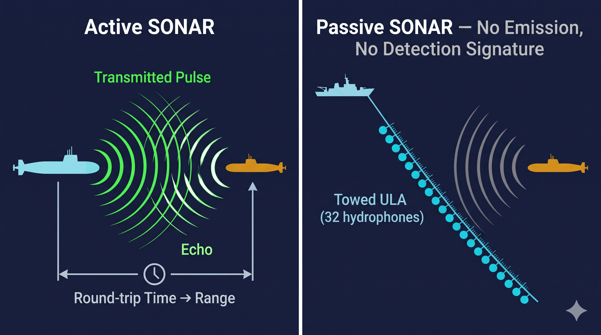
<br>

**Active SONAR** pings and listens for the echo. The round-trip time gives range.
The problem: the ping announces your presence. In naval operations, emitting an
active sonar pulse is tactically equivalent to turning on a spotlight.

**Passive SONAR** only listens. A towed array — a long cable with hydrophones
spaced along its length — is dragged behind the vessel. The array detects acoustic
energy radiated by the target itself (machinery noise, propeller cavitation). It
produces no detectable signature. The cost: there is no round-trip timing, so
range cannot be determined directly. The only geometric information is the
**direction of arrival** of the wavefront.

**Why underwater, not in air?**

Sound travels at 343 m/s in air and **1500 m/s in water** — over four times faster.
This has two consequences:

1. The element spacing for a given frequency is 4× larger underwater, making
   towed arrays physically realisable at low frequencies (the array does not need
   to be microscopically small).
2. Sound attenuates far more slowly underwater than electromagnetic waves. A 1 kHz
   acoustic signal can propagate thousands of kilometres in the ocean SOFAR channel.
   Radar, by contrast, does not penetrate water at all.

These properties make **acoustics the only practical long-range sensing modality
underwater**.

---

### 2.2 Towed Array Signal Reception

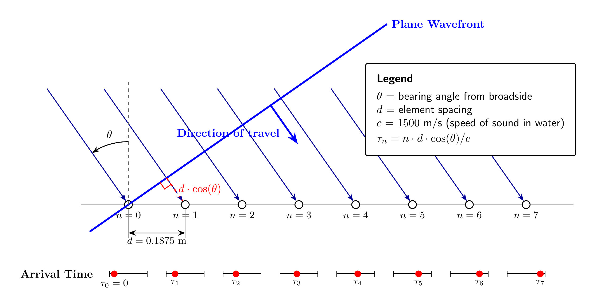
<br>
A plane wave from bearing θ arrives at each sensor with a small additional delay
relative to sensor 0. The delay accumulates linearly across sensors:

```
τ_n = n · d · cos(θ) / c
```

This **inter-sensor delay pattern is the only geometric information in the data**.
The DOA estimation problem reduces to recovering θ from these tiny timing
differences — which are fractions of a millisecond.

**Why measure from broadside and not end-on?**

The array is sensitive to the component of the wavefront direction **along** the
array axis. At broadside (θ = 90°), `cos(90°) = 0` — the wavefront arrives
simultaneously at all sensors. No delay, no spatial information. At endfire
(θ = 0°), `cos(0°) = 1` — maximum delay gradient. Most literature measures θ
from the array axis (so endfire = 90°), but this code uses the complementary
convention (broadside = 90°) following the thesis, which is more intuitive for
a towed array deployed perpendicular to the vessel track.

**Far-field assumption (plane wave):**

The simulation assumes all sources are in the **far field** of the array — far
enough that the wavefront curvature is negligible and the plane-wave approximation
holds. The far-field criterion for an array of aperture `L` and wavelength `λ` is:

```
r  ≫  2L² / λ

For this array at 1300 Hz:
  L = 31 × 0.1875 = 5.81 m
  λ = 1500 / 1300 = 1.15 m
  2L²/λ ≈ 58.7 m   →   source must be >> 60 m away
```

All naval targets of interest are kilometres away. The far-field assumption holds.

---

### 2.3 The Array Data Model Y = S + Z

The received signal at the n-th hydrophone is the sum of all source contributions
plus noise:
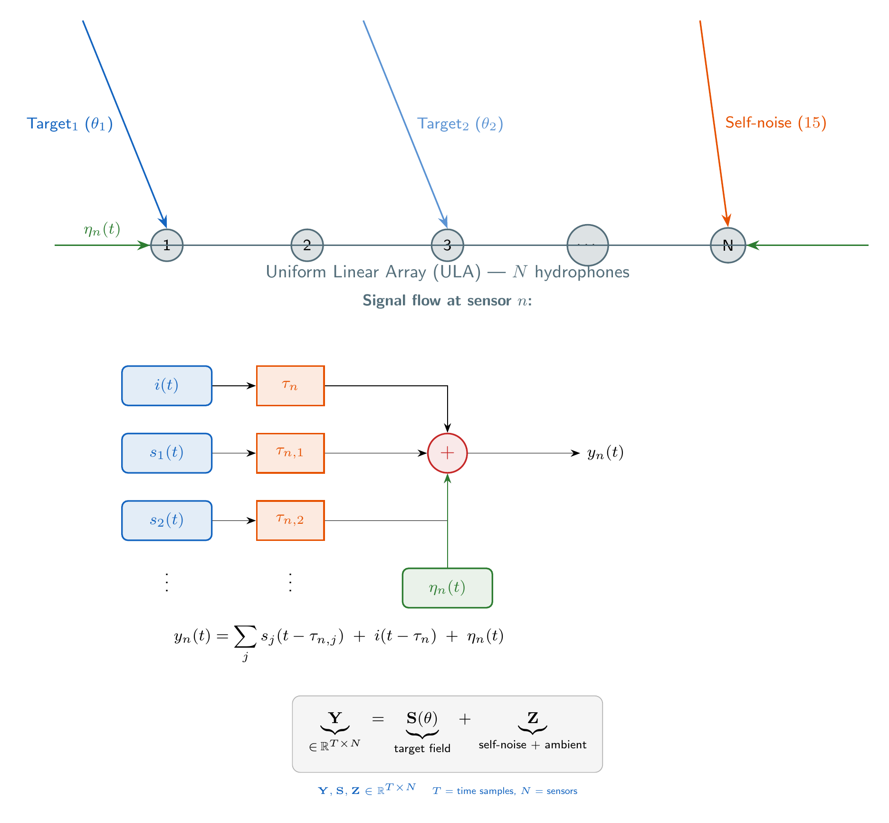

Where:
- `s_j(t)` — scalar source waveform from the j-th target (BB0 tone or BB1 cavitation)
- `τ_{n,j}` — geometric delay from target j to sensor n: `n · d · cos(θ_j) / c`
- `i(t)` — self-noise waveform (the towing vessel's own machinery / propeller)
- `τ_n` — geometric delay from the towing platform to sensor n
- `η_n(t)` — independent bandpass Gaussian ambient ocean noise at sensor n

Stacking all N sensor signals column-wise into a matrix:

```
Y  =  [y_1 | y_2 | … | y_N]  ∈  ℝ^{T × N}

Y  =  S(θ)  +  Z

     ├─────┘  └───┘
     target      interference + ambient noise
     field       (self-noise at 15° + isotropic ambient)
```

This is the **Array Data Model (ADM)**. Every training sample is one realisation
of this matrix. The label is the integer bearing θ (in degrees) of the target.

**Why is Z dominated by self-noise?**

The platform generating the towed array — typically a warship — is acoustically
loud. Its own propulsion machinery radiates intensely, and the towed cable picks
it up from a fixed direction (the vessel bearing). The simulation models this as a
strong tone at 1200 Hz coming from a fixed bearing of 15°, with SINR = −30 dB
meaning the interference is 1000× more powerful than the target.

---

## 3. Module Architecture

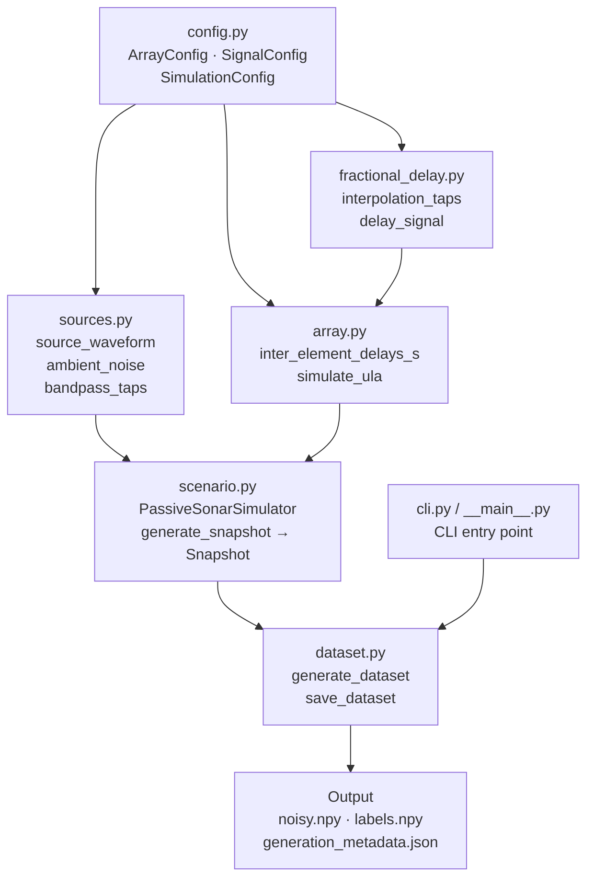

Each module has a single responsibility and depends only downward in this graph.
`config.py` is the root — every other module reads from it. `cli.py` is the only
entry point that orchestrates the full pipeline.

---

## 4. High-Level Pipeline

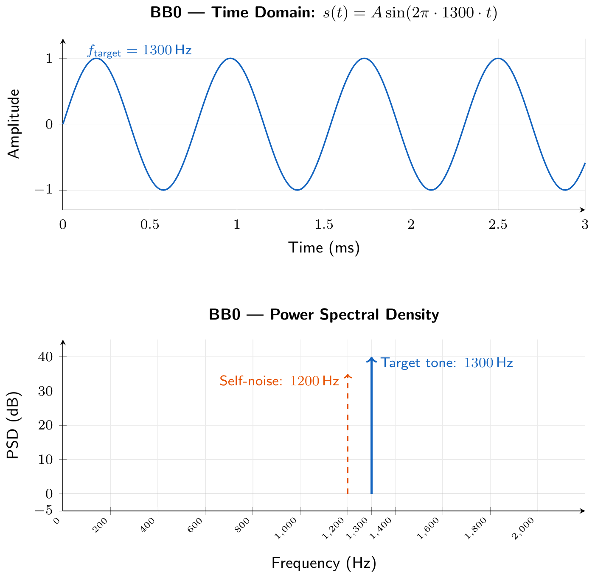


**Data shape at each stage:**

| Stage | Shape | Description |
|---|---|---|
| After source synthesis | `(T,)` | Scalar source waveform, one frame |
| After spatialization | `(T, M)` | One snapshot matrix per bearing |
| After noise mixing | `(T, M)` | Full `Y = S + Z` observation |
| After dataset assembly | `(N, T, M)` | N = n_bearings × repeats |
| Saved `.npy` tensor | `(N, 4096, 32)` | float32, ready for PyTorch DataLoader |

---

## 5. Module Deep-Dives

### 5.1 Configuration — `config.py`

All physical parameters are frozen dataclasses. Nothing is hard-coded elsewhere.

```
ArrayConfig
├── n_sensors          = 32          # hydrophones in the ULA
├── sound_speed_mps    = 1500.0      # m/s (seawater, ~15°C, ~100m depth)
├── design_frequency_hz= 4000.0      # spatial Nyquist criterion frequency
├── sample_rate_hz     = 4096.0      # Hz — kept close to signal band top
└── element_spacing_m  = c / (2·f)  # = 0.1875 m  (derived property)

SignalConfig
├── start_frequency_hz = 100.0       # bandpass filter low edge
├── end_frequency_hz   = 2000.0      # bandpass filter high edge
├── fir_order          = 512         # FIR tap count (determines transient length)
├── self_noise_freq_hz = 1200.0      # self-noise (interference) tone frequency
├── target_freq_hz     = 1300.0      # target tone frequency
├── am_index           = 0.5         # AM modulation depth (BB1)
├── am_frequencies_hz  = (5.0, 10.0) # blade-rate modulation frequencies (BB1)
├── interference_bearing_deg = 15.0  # self-noise locked at this bearing
└── tone_amplitude     = 1.0         # pre-scale of the tone component

SimulationConfig
├── array              = ArrayConfig()
├── signal             = SignalConfig()
├── broadband          = False        # False = BB0, True = BB1
├── sinr_db            = -30.0        # target SINR in dB
├── interference_snr_db= 20.0         # self-noise amplitude
├── duration_s         = 1            # seconds per snapshot
├── add_ambient_noise  = True
└── seed               = None         # RNG seed for reproducibility
```

**Why is element spacing a derived property?**

The spatial Nyquist criterion states that to avoid grating lobes (spatial aliasing),
the element spacing must satisfy:

```
d ≤ λ_min / 2  =  c / (2 · f_max)

d = 1500 / (2 × 4000) = 0.1875 m
```

Above 4000 Hz the array would alias. Since the signal band tops out at 2000 Hz,
we have a comfortable 2× margin. The value is not an input but a consequence of
the physics — so it is a `@property` on `ArrayConfig`.

---

### 5.2 Source Synthesis — `sources.py`

Produces a scalar (single-channel) waveform representing one acoustic source
before it is spatialised across the array.

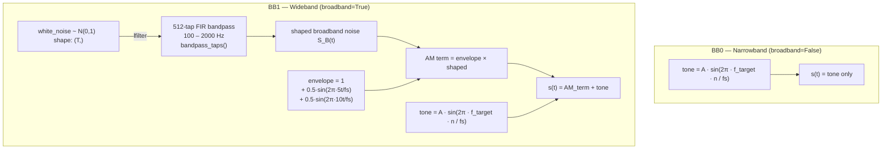

**BB0 — Narrowband physics:**
Rotating machinery (turbines, shafts, pumps) radiates strong tonal energy at
characteristic frequencies tied to shaft rotation rates and gear-tooth counts.
These are stable sinusoids that persist for minutes or hours. The classifier
must learn to localise the phase progression of a single tone across 32 sensors.

**BB1 — Wideband physics:**
A propeller under load sheds vapour bubbles from its tips (cavitation). When
these bubbles collapse, they emit broadband acoustic impulses. The cumulative
effect is a continuous noise floor across the signal band. The periodic rotation
of the blades modulates this noise at the blade-rate harmonics (5 Hz and 10 Hz
for a typical 2-bladed propeller at low RPM). The AM envelope captures this.

**Why add a tone to BB1?**

Real vessels produce both. Machinery noise (tonal) is always present alongside
cavitation (broadband). The tone at 1300 Hz ensures the target has both spectral
components, making BB1 strictly harder than BB0 — the classifier cannot rely on
a single frequency.

**Ambient noise** (`ambient_noise()`) is modelled as independent, bandpass-filtered
Gaussian noise per sensor — uncorrelated across sensors and zero-mean. This
represents the diffuse ocean background (biological noise, distant shipping,
thermal noise). It is spatially incoherent by construction.

---

### 5.3 Fractional Delay — `fractional_delay.py`

This is the most numerically precise module in the pipeline.

**Why fractional delay matters:**

The geometric delay `τ_n = n · d · cos(θ) / c` converts to samples as
`τ_n · f_s`. This is almost never an integer. At θ = 45°, sensor 10:

```
τ_10 = 10 × 0.1875 × cos(45°) / 1500  =  8.84 × 10⁻⁴ s
τ_10,samp = 8.84 × 10⁻⁴ × 4096  =  3.62 samples
```

Rounding to 4 samples introduces a **0.38-sample phase error** — equivalent to a
**phase shift of 0.038 cycles at 1300 Hz**, or **13.7°**. The bearing information
we are trying to preserve is carried in inter-sensor phase differences of the same
order of magnitude. Integer rounding would corrupt it.

<!-- [IMG-GEN-06] Replace with docs/images/generation/fractional_delay_lmmse.png -->


**The LMMSE solution:**

Split the delay into integer and fractional parts:

```
τ_n,samp  =  D_int  +  D_frac

D_int  = floor(τ_n,samp)     →  integer sample shift
D_frac = τ_n,samp − D_int    →  residual fractional part  ∈ [0, 1)
```

The integer shift is trivially realised by a FIR impulse with a single nonzero
tap at position `D_int`. The fractional part requires an interpolation filter.

A 2-tap LMMSE (Minimum Mean Squared Error) filter `[h₀, h₁]` is designed to
minimise the mean squared interpolation error over the signal passband
`[f_low, f_high]`. The two taps are found by solving a 2×2 linear system:

```
Gram matrix G (2×2):
  G[0,0] = G[1,1] = 1
  G[0,1] = G[1,0] = cos(ω_c) · sin(ω_B) / ω_B

  ω_c = π(f_high + f_low) / fs    (normalised band centre)
  ω_B = π(f_high − f_low) / fs    (normalised half-bandwidth)

Right-hand side r:
  r[0] = cos(ω_c · D_frac) · sinc(ω_B · D_frac)
  r[1] = cos(ω_c · (1−D_frac)) · sinc(ω_B · (1−D_frac))

[h₀, h₁] = G⁻¹ · r
```

The composite FIR is an impulse of length `D_int + 2` with the two taps placed
at positions `D_int` and `D_int + 1`:

```python
impulse = np.zeros(D_int + 2)
impulse[D_int : D_int + 2] = [h₀, h₁]
output = lfilter(impulse, 1.0, signal)
```

**Why LMMSE and not windowed-sinc?**

Windowed-sinc interpolation minimises energy at all frequencies equally. LMMSE
concentrates the optimisation over the actual signal passband (100–2000 Hz),
ignoring frequencies outside the band where errors do not matter. This gives
better phase fidelity within the band at the cost of only 2 taps — a
computationally cheap and accurate solution.

---

### 5.4 Array Spatialization — `array.py`

Applies the geometric inter-element delays to a scalar waveform to produce the
full `(T, M)` snapshot matrix.

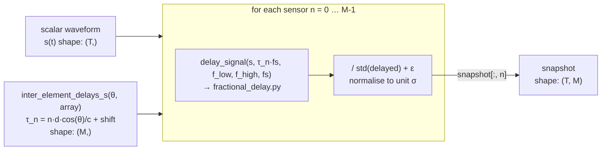

**The delay shift:**

```python
tau = sensor_index * (d * np.cos(np.deg2rad(θ)) / c)
return tau + np.max(np.abs(tau))   # shift so all delays ≥ 0
```

The raw delay for sensor 0 is always 0. For other sensors the delay can be
positive or negative depending on the sign of `cos(θ)`. Shifting by the maximum
absolute value ensures every sensor delay is non-negative — required because
`lfilter` cannot apply negative (non-causal) delays. This is a global time shift
and does not affect inter-sensor relative phases.

**Per-channel normalisation:**

After applying the fractional delay, each channel is divided by its own standard
deviation. This decouples the amplitude from the spatial phase pattern. The
classifier must learn from the **phase structure** (the bearing information), not
from absolute amplitude differences that are artefacts of the filter applied.

---

### 5.5 Scenario Assembly — `scenario.py`

`PassiveSonarSimulator` is the orchestrator. It calls every module above and
combines them into a single labelled observation.

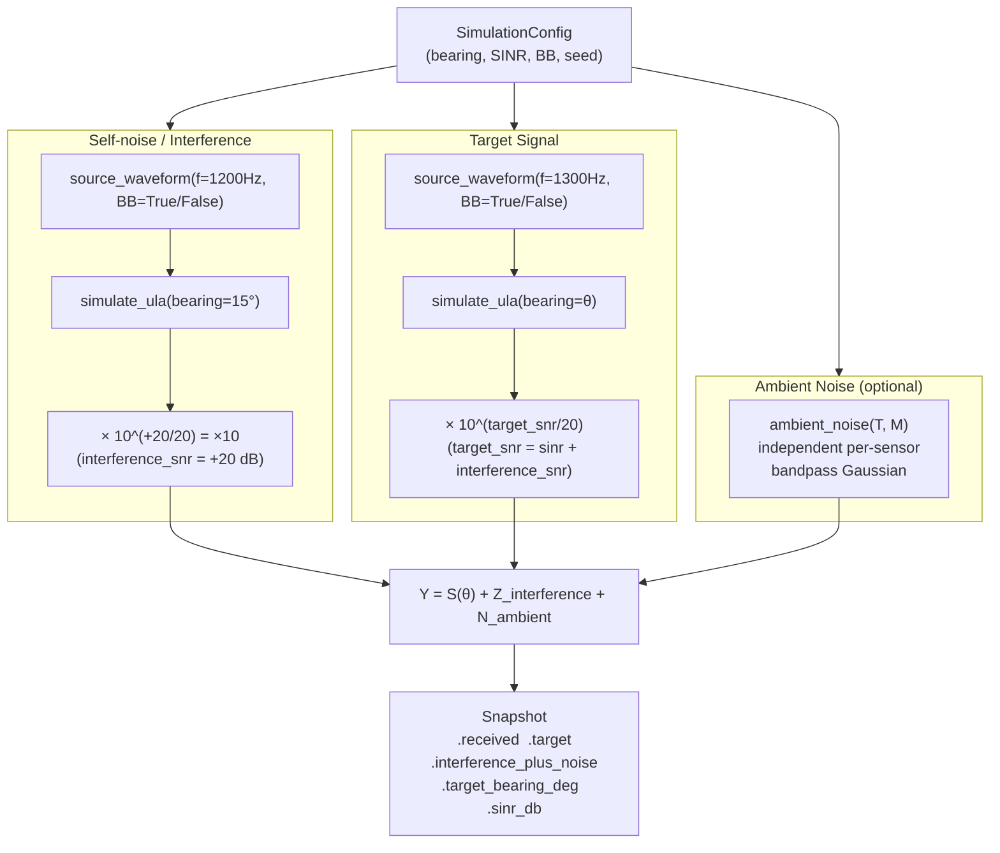

**Key design: duration stacking**

When `duration_s > 1`, the simulator generates one second at a time in a loop,
concatenating the frames. Within a multi-second snapshot, the target bearing can
optionally drift by `target_bearing_increment_deg` per second — simulating slow
platform motion. This allows training on realistic bearing-rate scenarios without
altering the core 1-second physics.

---

### 5.6 Dataset Writer — `dataset.py`

`generate_dataset` sweeps across all requested bearings (and optionally repeats),
calling `PassiveSonarSimulator.generate_snapshot()` for each, then stacks the
results.

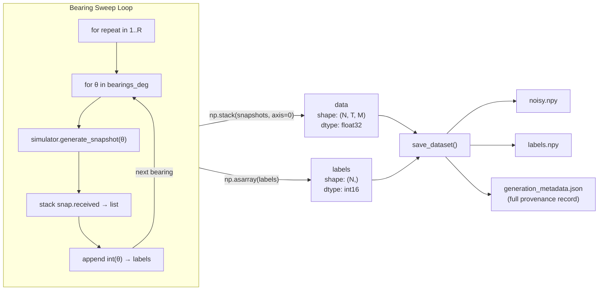

`save_dataset` writes a **JSON provenance file** alongside the arrays containing
every parameter used to generate the data: seed, SINR, bearing range, sample
rate, sensor count, and more. This ensures any dataset on disk can be fully
reproduced from its metadata alone.

---

## 6. BB0 vs BB1 — Narrowband and Wideband Modes

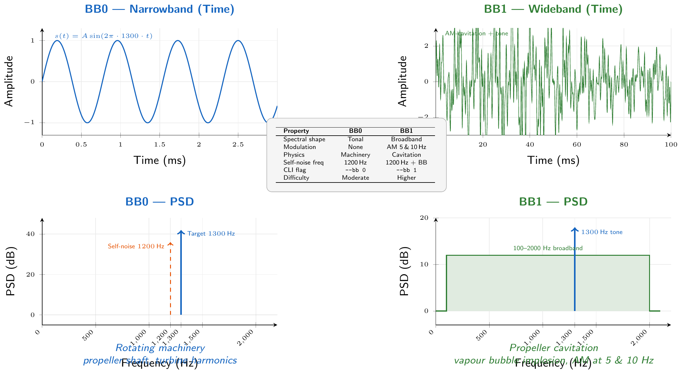

| Property | BB0 | BB1 |
|---|---|---|
| Spectral shape | Single tone at 1300 Hz | Flat 100–2000 Hz + tone |
| Modulation | None | AM at 5 Hz and 10 Hz |
| Waveform appearance | Sinusoidal | Amplitude-modulated noise |
| Physics origin | Machinery harmonics | Propeller cavitation |
| Difficulty for DOA | Moderate (clear tone) | Higher (broadband spatial noise) |
| Self-noise counterpart | 1200 Hz tone | 1200 Hz tone + cavitation |

**Which mode is harder?**

BB1. The wideband energy adds correlated noise across all sensors (from the
interference). The target's broadband component overlaps spectrally with the
ambient noise. The model cannot rely on a single tone frequency — it must extract
directional information from the full 100–2000 Hz band.

---

## 7. The Sub-Sample Delay Problem

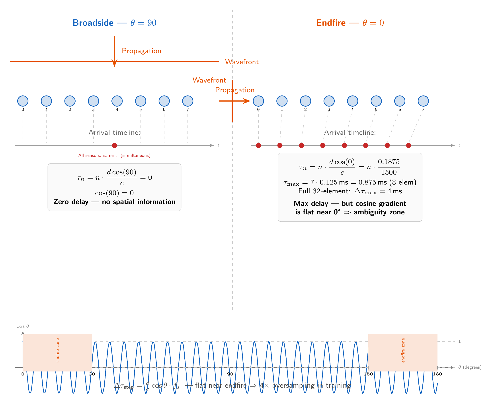

The inter-sensor delay varies continuously with bearing:

```
τ_n,samp = n · d · cos(θ) · fs / c

At fs = 4096 Hz, d = 0.1875 m, c = 1500 m/s:

  step per sensor = d · cos(θ) · fs / c = 0.512 · cos(θ) samples

  θ = 90° (broadside):  step = 0.000 samples  →  zero delay  →  no spatial info
  θ = 45°:              step = 0.362 samples  →  all fractional
  θ =  0° (endfire):    step = 0.512 samples  →  maximum delay
```

At broadside the array is blind — all sensors receive simultaneously. At endfire
the delay is maximal but the cosine function is near its flat maximum, meaning
**small bearing changes near 0° or 180° produce very small changes in delay**.
This is the endfire ambiguity.

```
Sensor-to-sensor delay step (samples) vs bearing:

  0.5 ─┐
       │          ╲
  0.4 ─┤            ╲
       │              ╲
  0.3 ─┤                ╲
       │                  ╲_______
  0.1 ─┤                          ╲___
       │                                ╲____
  0.0 ─┴────────────────────────────────────── θ
       0°      30°      90°     150°    180°
         ←endfire→            ←endfire→
```

The flat regions near endfire are why the training pipeline applies 4× augmentation
to bearings 0°–30° and 150°–180° — the network sees far fewer unique delay
patterns from those angles.

---

## 8. SINR Control and Noise Mixing

The simulator provides explicit SINR control via two decoupled amplitude scalings:

```
interference_snr_db  = +20 dB   →   amplitude = 10^(20/20)  = 10.0   (fixed, strong)
sinr_db              = -30 dB   →   target amplitude derived as:

  target_snr_db   = sinr_db + interference_snr_db
                  = -30     + 20
                  = -10 dB

  target_amplitude = 10^(-10/20) = 0.316
```

The interference is 31.6× louder than the target. The configured SINR is the ratio:

```
SINR = target_power / interference_power
     = (0.316)² / (10.0)²
     = 0.1 / 100
     = 10^(-30/10)    ✓  → −30 dB
```

**Why separate the two SNRs?**

The interference SNR sets the absolute loudness of the platform self-noise. The
SINR sets how deeply buried the target is relative to that fixed interference.
Keeping them separate allows independent study of: (a) ambient noise level
variation and (b) target detectability, without coupling the two.

---

## 9. FIR Transient Removal

The 512-tap bandpass filter is applied with `lfilter` — a causal, zero-delay
implementation. Every time a new waveform frame starts, the filter has zero
initial state, creating a **startup transient** in the first 512 samples.

```
Total frame:  4096 + 512 = 4608 samples
                            └──── extra generated to absorb transient

After filtering, discard first 512:
  snapshot[cfg.signal.fir_order:]   →   4096 clean samples
```

This applies to every source waveform frame (target, self-noise) and to the
ambient noise. The resulting 4096-sample snapshot is guaranteed to contain only
steady-state filter output — no startup artefacts.

---

## 10. Output Format

`save_dataset` writes three files to `--out-dir`:

| File | Shape / Type | Description |
|---|---|---|
| `noisy.npy` | `(N, 4096, 32)` float32 | Received array `Y` — input to the model |
| `labels.npy` | `(N,)` int16 | Integer bearing in degrees (0–180) |
| `generation_metadata.json` | JSON object | Full provenance — all parameters, seed, shapes |

**Memory footprint:**

```
181 bearings × 1 repeat × 4096 samples × 32 sensors × 4 bytes = 95 MB per dataset
```

For 5 repeats: 475 MB. The `.npy` format supports memory-mapped loading
(`np.load(..., mmap_mode='r')`), which the training `DataLoader` uses by default
to avoid loading the full dataset into RAM.

**Provenance JSON example:**

```json
{
  "shape": [181, 4096, 32],
  "dtype": "float32",
  "layout": "(n_samples, n_time, n_sensors)",
  "broadband": false,
  "bb_index": 0,
  "sinr_db": -30.0,
  "interference_snr_db": 20.0,
  "duration_s": 1,
  "sample_rate_hz": 4096.0,
  "n_sensors": 32,
  "element_spacing_m": 0.1875,
  "sound_speed_mps": 1500.0,
  "target_frequency_hz": 1300.0,
  "interference_bearing_deg": 15.0,
  "seed": 42
}
```

---

## 11. CLI Reference

Entry point: `python -m sonar_sim.generation` or `sonar-generate` (after `pip install -e .`)

```
usage: sonar-generate [-h] [--bb {0,1}] [--sinr SINR]
                      [--interference-snr INTERFERENCE_SNR]
                      [--duration DURATION] [--bearings BEARINGS]
                      [--repeats REPEATS] [--seed SEED]
                      [--out-dir OUT_DIR] [-v]
```

| Argument | Default | Description |
|---|---|---|
| `--bb` | `0` | Signal type: `0` = BB0 narrowband, `1` = BB1 wideband |
| `--sinr` | `-30.0` | Target SINR in dB |
| `--interference-snr` | `20.0` | Self-noise amplitude in dB |
| `--duration` | `1` | Seconds of signal per bearing snapshot |
| `--bearings` | `0:180:1` | Bearing range as `start:stop:step` or `a,b,c` list |
| `--repeats` | `1` | Number of independent snapshots per bearing |
| `--seed` | `42` | RNG seed for full reproducibility |
| `--out-dir` | `data/` | Output directory |
| `-v` | off | Verbose debug logging |

**Common recipes:**

```bash
# Full BB0 sweep (181 samples) — default settings
python -m sonar_sim.generation --bb 0 --out-dir data/bb0

# Full BB1 sweep
python -m sonar_sim.generation --bb 1 --out-dir data/bb1

# Higher SNR for sanity checks (easier problem)
python -m sonar_sim.generation --bb 0 --sinr 0 --out-dir data/bb0_easy

# Large dataset: 5 repeats per bearing (905 samples)
python -m sonar_sim.generation --bb 0 --repeats 5 --seed 42 --out-dir data/bb0_x5

# Specific bearings only
python -m sonar_sim.generation --bearings 0,45,90,135,180 --out-dir data/bb0_key_angles

# Broadside region only, fine step
python -m sonar_sim.generation --bearings 60:120:0.5 --bb 1 --out-dir data/bb1_broadside
```

---

## 12. Python API

For programmatic use without the CLI:

```python
from sonar_sim.generation.config import SimulationConfig, ArrayConfig, SignalConfig
from sonar_sim.generation.scenario import PassiveSonarSimulator
from sonar_sim.generation.dataset import DatasetSpec, generate_dataset, save_dataset
import numpy as np
from pathlib import Path

# --- Single snapshot ---
cfg = SimulationConfig(broadband=False, sinr_db=-30.0, seed=42)
sim = PassiveSonarSimulator(cfg)
snap = sim.generate_snapshot(target_bearing_deg=60.0)

print(snap.received.shape)           # (4096, 32) — full Y = S + Z
print(snap.target.shape)             # (4096, 32) — S(θ) only
print(snap.interference_plus_noise.shape)  # (4096, 32) — Z only
print(snap.target_bearing_deg)       # 60.0
print(snap.sinr_db)                  # -30.0

# --- Full dataset ---
cfg = SimulationConfig(broadband=True, sinr_db=-30.0, seed=0)
spec = DatasetSpec(
    bearings_deg=np.arange(0, 181, 1.0),
    repeats=3,
    output_dir=Path("data/bb1_x3"),
)
data, labels = generate_dataset(cfg, spec)
# data.shape  → (543, 4096, 32)
# labels      → array([0, 1, 2, ..., 180, 0, 1, ...], dtype=int16)

save_dataset(data, labels, cfg, Path("data/bb1_x3"))
```

---

## 13. Validation

The physics implementation is validated by **51 unit tests** and a standalone
**22-check smoke test**:

```bash
# Full test suite
python -m pytest tests/test_generation.py -v

# Standalone smoke test — runs without pytest, checks physics directly
python -m sonar_sim._smoke.smoke_test
```

**Key validation checks:**

| Check | Method | Expected |
|---|---|---|
| `element_spacing_m = c / (2·f_max)` | Exact formula check | 0.1875 m |
| `τ_n = n·d·cos(θ)/c` at 6 bearings | Compare computed vs formula | FP precision |
| BB0 PSD peak at 1300 Hz | `np.argmax(np.abs(np.fft.rfft(...)))` | Exact bin |
| BB1 in-band / out-of-band PSD ratio | `10·log10(mean_in / mean_out)` | ≥ 18.5 dB |
| SINR measured from output vs configured | `10·log10(power_S / power_Z)` | ±0.1 dB |
| `Y = S + Z` (additive decomposition) | `np.allclose(Y, S+Z)` | True |
| FIR transient discarded | First 512 samples absent from output | True |
| Cross-correlation lag at endfire | `np.argmax(xcorr)` vs `d·cos(θ)·fs/c` | ±0.13 samples |
| Per-channel normalisation to unit σ | `np.std(snapshot[:, n])` | ≈ 1.0 |

---

*For the image generation prompts used to create the diagrams in this README,
see [`docs/image_prompts/generation_diagrams.md`](../../docs/image_prompts/generation_diagrams.md).*
